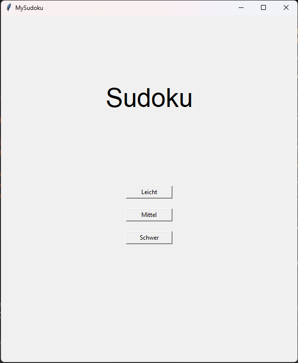
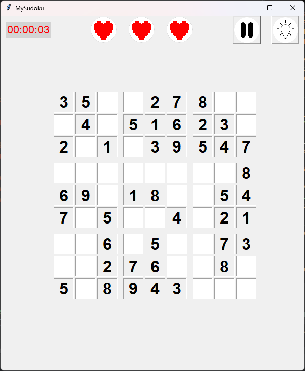

# Sudoku App

Eine kleine Sudoku App, die ich als Student in meiner Freizeit entwickelt habe. Sie baut auf einem Projekt aus dem ersten Semester auf, wobei ich einen Sudoku Löser programmiert habe.

<p align="center">
  
  
</p>

## Features

- Generierung von Sudoku-Rätseln in mehreren Schwierigkeitsgraden (leicht, mittel, schwer)
- Eingabe von Zahlen in die jeweiligen Felder
- Automatische Validierung: Fehler werden markiert und Leben abgezogen
- Timer für die benötigte Zeit pro Sudoku
- Pausenmenü um zum Menü zurückzukehren
- Tipp Funktion, falls man nicht voran kommt

## Technologien

| Bereich | Technologie |
|---|---|
| Sprache | Python |
| Framework / UI | tkinter |
| Paketverwaltung | pip (requirements.txt) |
| Tests | pytest |

## Installation & Start 

**Voraussetzungen:** Python 3.10+

```bash
# Repository klonen
git clone https://github.com/HahnTo/Sudoku_App.git
cd Sudoku_App

# Virtuelle Umgebung erstellen und aktivieren
python -m venv .venv
source .venv/bin/activate      # Windows: .venv\Scripts\activate

# Abhängigkeiten installieren
pip install -r requirements.txt

# App starten
python main.py
```

Die App selbst benötigt keine externen Pakete – sie läuft nur mit der Python-Standardbibliothek inklusive `tkinter`. `requirements.txt` installiert lediglich `pytest` für die Tests und `pyinstaller` für den Build. Unter Linux muss `tkinter` ggf. nachinstalliert werden (`sudo apt install python3-tk`).

## Benutzung

1. Schwierigkeitsgrad wählen und neues Spiel starten
2. Feld anklicken und Zahl eingeben (1–9)
3. Bei einem Fehler kommt eine Meldung und es geht normal weiter
4. Nach 3 Fehlern bricht das Spiel ab und man kann ein neues Sudoku generieren lassen

## Funktionsweise

Kurz erklärt, wie das Herzstück der App funktioniert:

- **Lösen:** Das Lösen läuft als Backtracking, bei dem der Solver das erste leere Feld sucht und dort die Zahlen 1 bis 9 durchprobiert. Jede Zahl wird sofort mit `is_valid` gegen Zeile, Spalte und 3×3-Block geprüft. Passt eine Zahl, geht es rekursiv zum nächsten leeren Feld, sonst wird sie wieder zurückgesetzt – so entsteht am Ende die vollständige Lösung.

- **Generieren:** Zuerst wird ein leeres Gitter mit demselben Backtracking gefüllt, wobei die Zahlen pro Feld zufällig gemischt werden, sodass jedes Mal ein anderes gültiges Sudoku entsteht. Danach werden genau so viele Felder zufällig geleert, wie der Schwierigkeitsgrad vorgibt. Eine Prüfung, ob das entstandene Rätsel noch eindeutig lösbar ist, gibt es aktuell nicht.

- **Schwierigkeitsgrad:** Der Schwierigkeitsgrad steuert ausschließlich die Anzahl der leeren Felder, die beim Generieren entfernt werden. Die drei Stufen liegen als Enum `Difficulty` vor: leicht (20–30 leere Felder), mittel (35–40) und schwer (45–50). Wie schwer ein Rätsel tatsächlich ist (z. B. welche Lösungstechniken nötig sind), wird nicht gemessen – die Einteilung ist also rein quantitativ.

## Projektstruktur

```
├── main.py                  # Einstiegspunkt: startet die App
├── requirements.txt         # Abhängigkeiten für Tests und Build
├── pyproject.toml           # pytest-Konfiguration
├── main.spec                # PyInstaller-Konfiguration (exe-Build)
├── src/
│   └── sudoku_app/
│       ├── controller.py    # Vermittelt zwischen Model und View
│       ├── model.py         # Solver, Generator, Spielzustand (Leben, Tipps)
│       ├── view.py          # tkinter-Oberfläche
│       ├── difficulty.py    # Enum für die Schwierigkeitsgrade
│       ├── sudoku.txt       # Start-Sudoku, das beim Start gelöst wird
│       └── images/          # Icons (Herz, leeres Herz, Pause, Tipps)
├── tests/                   # pytest-Tests (Model, Controller, View)
├── docs/                    # Screenshots
└── README.md
```

## Was ich dabei gelernt habe

- Umsetzung eines Backtracking-Algorithmus
- Trennung von Logik und Oberfläche
- Umgang mit Git und GitHub im Projektalltag
- Umgang mit generiertem Code der KI für die Tests
  
## Geplante Erweiterungen
- [ ] Speichern und Laden von Spielständen
- [ ] Highscore / Statistiken

## Lizenz

Dieses Projekt steht unter der [MIT-Lizenz](LICENSE).

## Kontakt

**Tobias Hahn** – Student Medien- und Kommunikationsinformatik, Hochschule Reutlingen  
Tobias.Hahn@student.reutlingen-university.de
